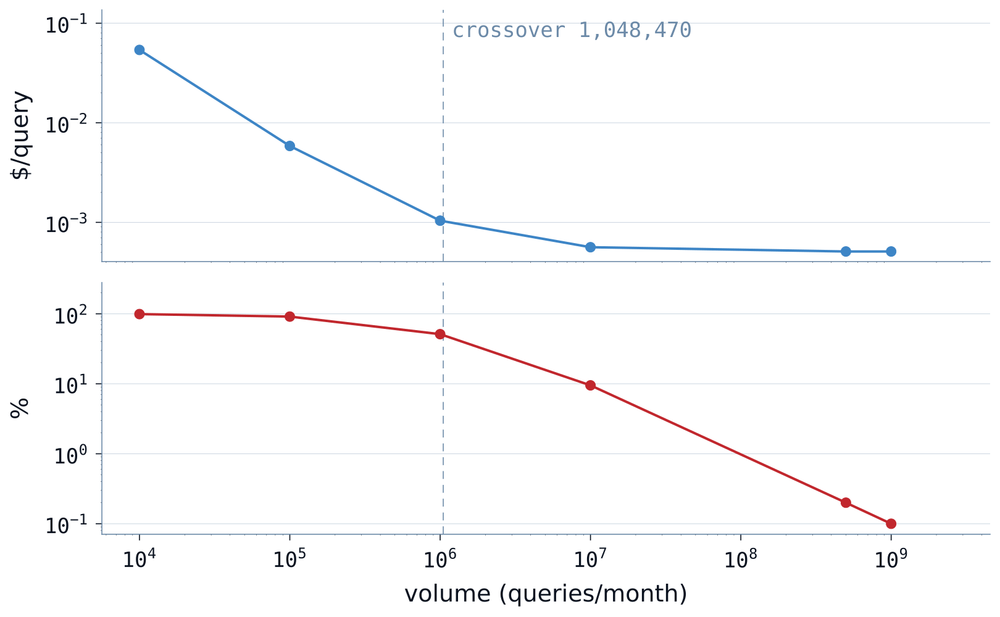

# Executive Engineering Report — simple-rag

This report shows what asynchronous document ingestion costs per document,
how many queries per second the deployment sustains,
what the system costs at rest, and how that cost spreads over volume.

- **Report** — `simple-rag` · v1.0 · 2026-09-09
- **System under test** — chunker `sha-404a267` · indexer `sha-32365dc` · api `sha-bafdc1f` · tei
  `cpu-1.6` · commit `1ef1f0a8`, 2026-09-05. TEI ran at `cpu 6 / 8` for r1000 only, `3 / 4`
  everywhere else (§3.2)
- **Envelope** — text-layer PDF corpus, bulk drop · N ≤ 125 concurrent ingestion pods · R ≤ 1000 req/s\* · EKS + Karpenter,
  KEDA (serving from 2 replicas, ingestion from zero), self-hosted Qdrant, TEI `bge-small-en-v1.5` · `eu-central-1`
- **Executions** — `00-baseline` · `01-ingestion` · `02-inference`, raw data in
  `executions/*/data/`
- **Cost source** — AWS Cost and Usage Report 2.0 · USD · method in `methodology.md` §9
- **Figures** — measured unless marked: ᴰ derived · ᴿ recorded · ᴱ estimated
- **Supersedes** — —
- **Changes** — first revision

---

## Coverage

| Area | Status | Evidence |
| :--- | :--- | :--- |
| Ingestion throughput, cost per run and cost per 1M documents | measured · unit cost derived ᴰ | §3.1 · `01-ingestion/M10` · `D25` |
| Per-component share of ingestion cost | derived ᴰ | §4.2 · `01-ingestion/M12` |
| TEI cost caused by ingestion | measured, two readings | cash: §3.1 `TEI $ (cash)` · `01-ingestion/D23` · apportioned: §4.2 · `01-ingestion/M12` |
| Unused node capacity, fleet-wide | recorded ᴿ | §4.4 · `01-ingestion/M12` |
| Ingestion constraint | measured | §3.1 · `01-ingestion/M6` |
| Sustained query rate, the replicas it required and the query path constraint | measured | §3.2 · `02-inference/D15` · `M7` · `R14` |
| Retrieval cost per 1k queries — marginal | derived ᴰ | §4.2 · `02-inference/D16` |
| Generation cost per 1k queries — Bedrock | estimated ᴱ | §4.2 · `02-inference/E18` |
| Idle floor, split A / B / C | derived ᴰ | §4.1 · `00-baseline` §2 Floor |
| Errors found at rest, excluded from the floor | derived ᴰ | §4.1 · `00-baseline` §2 Floor errors table |
| Untaggable billing lines, mapped to the Floor rows that price them | recorded ᴿ | §4.1 · `00-baseline/R5` |
| Amortization across volumes | derived ᴰ | §4.3 |
| Break-even against Fargate, ingestion | derived ᴰ | §4.4 · `01-ingestion/D29` |
| Warm-up and consolidation-tail share | declared, not measured | the share of each run's bill that is node boot and teardown |
| Ingestion constraint beyond the indexer loop | declared, not measured | which component caps ingestion once the indexer loop is relieved. `01-ingestion` M15–M17 were not scraped |
| Ingest and query contention on shared Qdrant and TEI | declared, not measured | whether the latency target survives a backfill running underneath it. Not run: cluster torn down first (`02-inference` §3 Close checklist) |
| Scaler tuning — thresholds and cooldowns | declared, not measured | how much of convergence time is configuration rather than node provisioning |
| Query tail latency, p99 | declared, not measured | whether the slowest 1% of queries stays inside the latency target. Neither Envoy nor k6 was queried for it |
| Retrieval quality against quantization | declared, not measured | what INT8 compression costs in recall. INT8 SQ is a frozen given here |
| Behaviour above the sustained rate | out of scope | whether overload degrades or collapses the deployment. It needs served-rate and status-code instruments and its own runs |
| End-to-end latency including Bedrock generation | out of scope | what a user waits for once Bedrock answers |
| Reliability economics — Spot interruption under load | out of scope | the price of the resilience mechanism: work lost, duplicates, recovery time |
---

## 1. BLUF

* **Ingestion cost at the sweet spot** — $24,875<!--FD37--> / 1M docs ᴰ at N=25. N=10 below it costs
  $44,707<!--FD76--> ᴰ, and every N above it costs more. Fargate for the same two workers costs
  2.91<!--FD123-->× more at the same point (§4.4)
* **Sustained query rate** — 1000 req/s\*, held for 1m45s at 30 TEI replicas and
  0.02<!--FM62-->% errors. The full steady phase served 955<!--FM63--> req/s at 0.28<!--FM64-->%
  errors and misses the 0.1<!--FR29-->% error bound (`D15`). Without generation a query returns in ~40-60ms
  at p95 (§3.2)
* **Retrieval cost** — $0.00375<!--FD65--> / 1k queries ᴰ marginal, read from the campaign's CUR
  with the floor netted out once (§4.2). Generation is not included (Verdict)
* **Idle floor, Block B (dedicated to this feature)** — $534.12<!--FD26--> / month ᴰ (Block C total: $877.54<!--FD29--> ᴰ). This
  is what the feature costs with zero traffic on a platform that exists anyway

\* **1000 req/s** means the 1m45s hold above, not the r1000 window and not a proven ceiling (§3.2).

**What the measurements settled**

* **Ingestion is capped by code, not by hardware.** Nothing saturated at any N. The sequential
  loop in `apps/indexer/src/main.py` holds one TEI call in flight per pod, so throughput follows
  replica count: 26 TEI replicas were needed for 2.60 docs/min at N=125, and docs/min was
  still climbing when testing stopped on cost. Raising it takes a rewrite of that loop, not larger
  pods.
* **Qdrant is the query path's nearest ceiling, and it cannot scale out.** It reached 1.568<!--FM59--> of its 2<!--FR27-->-core limit, 78<!--FD137-->%, and two replicas
  hold one shard at every rate. TEI touched 97.5% of its CPU limit during r1000's ramp, and more
  replicas relieved it.
* **The defects cost more than the sizing.** Errors found at rest recur at $175.85<!--FD35-->/month
  (§4.1). Right-sizing every line in the floor saves $139.80<!--FD138--> ᴱ, and $52.56 of that is
  the two Bedrock endpoints, which count as defects, so sizing alone saves $87.24<!--FD152--> ᴱ.
* **The two paths want opposite operating points.** Cost per document rises with concurrency:
  $24,875<!--FD37--> ᴰ per 1M docs at N=25 against $88,161<!--FD72--> ᴰ at N=125. Effective cost
  per query, floor included, falls with rate: below ~54<!--FD143--> requests a second the bill is
  mostly floor, and at a billion queries a month the floor is 12.5<!--FD142-->% of it. Ingestion is
  cheapest run slowly, the query path is cheapest run hot, and they share no operating point, so
  spare capacity in one is not an argument for scheduling the other into it.

**Verdict** — **ship with guardrails.** Nothing found here blocks release, and both paths have
headroom at the volumes tested. Three of §5's values are conditions of release:
`single_nat_gateway = false` in production (`ADR-0017`), the budget alarm at
$1,032.84<!--FD56--> ᴱ/month and the ingestion concurrency cap at 20 ᴱ. Two gaps ship
declared. Generation cost, ~$0.51<!--FD39--> ᴱ per 1k queries, is an estimate no run has
confirmed, and at ~136<!--FD115--> ᴱ times the retrieval cost it is the largest number in the
query path (`docs/tech-debt.md` #9). The Fargate comparison covers N=25 only (#10). Every
query-path finding holds for an idle ingestion path, because contention was not tested (Coverage).

---

## 2. Workload Contract & Envelope

### 2.1 Ingestion — per document

- **Unit of work** — one source document, complete when its last chunk is upserted and counted in Qdrant `points_count`
- **Workload fixture** — 100-file / 1.38GB stratified sample (~9.5% of the full corpus, 10 size deciles, seed 42), bulk drop · median 8.77MB, p95 49.23MB · frozen at commit `bafdc1f` (2026-08-31, `00-baseline` §2)
- **Denominator** — 100 documents (files), frozen with the fixture. The same corpus is reloaded at every point, confirmed by an identical 84,018-chunk `points_count` (R21) at every point
- **Window** — opens at the first `s3:ObjectCreated`, closes when the ingestion pool reaches zero nodes and TEI returns to its always-on minimum, plus five minutes. Upload is outside the system under test

### 2.2 Query path — per query

- **Unit of work** — one search request, complete when the retrieved context is written to the response. Generation in Bedrock is outside the unit
- **Workload fixture** — 5 fixed query strings (`docs/report/scripts/load.js:57-63`), selected uniformly at random per request, replayed at a constant arrival rate against the collection produced by `01-ingestion`
- **Denominator** — queries served inside the steady phase, produced by each run rather than frozen
- **Window** — the whole generator run. It opens with both deployments at their always-on minimum, so it includes the scale-out ramp. The designed 60s stability check was not enforced: the preflight checks one instant (`02-inference` §2)
- **Steady phase** — the part of the window after replicas converge
- **Hold** — the longest stretch of the steady phase that serves the offered rate at a flat p95
- **Run names** — `rN` is the run offered N req/s, as in r1000

### 2.3 Conditions shared by both

- **Envelope** — `00-baseline` §2 Envelope
- **Metric sources** — `00-baseline` §1 · `01-ingestion/metrics.md` · `02-inference` §1
- **Autoscaling** — the Go API and TEI scale from two replicas each, their always-on minimum, under the triggers frozen in `00-baseline` §2. Every figure in this report is conditional on those triggers rather than on a replica count. On the ingestion path the ScaledJob cap is the swept axis N, so the indexer sitting at N is the design, not a ceiling. TEI stayed under its own cap there, 26 of 30 at N=125. TEI reached its `maxReplicaCount: 30` at r1000. `02-inference`'s validity rule excludes a point that sits at its ceiling, and this one is kept as the declared exception: TEI converged there and held the offered rate at the steady-state p95 with 0.02<!--FM62-->% errors (§3.2), so 30 replicas sufficed
- **Shared embedding service** — TEI (`tei-embeddings`), one deployment serving both paths. Ingestion runs raise its replica count, and that cost is charged to ingestion in §4.2 after the always-on minimum is subtracted
- **Worker packing density** — the ingestion pool is pinned to one Spot instance family, `c7g`, in three sizes (`xlarge`, `2xlarge`, `4xlarge`) so Karpenter can fall back when one Spot pool runs out of capacity. That gives ≈ 3–14 indexer pods per node, computed from frozen requests against allocatable, memory-bound, never observed live (`01-ingestion` §2). Every ingestion figure is conditional on this ratio
- **Scalar quantization** — INT8 SQ is a fixed parameter, chosen for memory footprint. Its effect on retrieval quality is not measured and is not claimed either way

---

## 3. Efficiency Frontier

### 3.1 Ingestion — throughput, cost and constraint

N=25 is the sweet spot, the cheapest operating point at $24,875<!--FD75--> ᴰ per 1M docs. Throughput is capped by
the indexer's code, not by any resource.

N is the `maxReplicaCount` set on both ScaledJobs, so it is a cap on concurrent pods, not observed
concurrency. The indexer filled the cap at every point (125 of 125 at N=125, `M5`). The chunker peaked
at ~20 whatever the N, because the 100-file corpus cannot keep more busy. Tested at N = 10, 25,
50, 75 and 125.

Cost per document is V-shaped with its floor at N=25. It rises at every step above 25, and N=10
below it is higher too ($44,707<!--FD76--> ᴰ): it ran 132.5 min against 61.7 min, and the fixed
per-hour costs ran with it.

Throughput rises with N and never flattens, so no knee was found: per-step gains run +113%, +40%,
+2.6%, then +11.6% again. If speed matters, stop at N=50: it buys +40% docs/min over N=25 for
$19,460<!--FD77--> ᴰ more per 1M docs. N=75 is the waste boundary: +39% cost for +2.6% docs/min
over N=50.

Nothing saturated, against the recorded hypothesis that the chunker would cap throughput. Neither
worker reached its CPU or memory limit at any N (`01-ingestion/M6`). The sequential loop in
`apps/indexer/src/main.py` holds one TEI call in flight per pod, so throughput follows replica
count. Raising it needs intra-pod parallelism in the indexer, and that cost is not measured.



| N | Docs/min | Wall time | TEI peak | Compute $ | TEI $ (cash) | Other $ | $/run | $/1M docs | Saturation signal |
| :--- | :--- | :--- | :--- | :--- | :--- | :--- | :--- | :--- | :--- |
| 10 | 0.76 | 132.5 min | 3 | $1.55 | $0.31<!--FM25--> | $2.61 | $4.47<!--FD71--> ᴰ | $44,707<!--FD76--> ᴰ | none, chunker also at the cap (the only point below its ~20) |
| 25 | 1.62 | 61.7 min | 4 | $1.09 | $0.01<!--FM24--> | $1.38 | $2.49<!--FD70--> ᴰ | **$24,875<!--FD75-->** ᴰ | none |
| 50 | 2.27 | 44.0 min | 10 | $1.26 | $0.29<!--FM23--> | $2.88 | $4.43<!--FD69--> ᴰ | $44,335<!--FD74--> ᴰ | none |
| 75 | 2.33 | 42.9 min | 16 | $1.54 | $0.52<!--FM22--> | $4.10 | $6.16<!--FD68--> ᴰ | $61,573<!--FD73--> ᴰ | none |
| 125 | 2.60 | 38.5 min | 26 | $2.01 | $0.82<!--FM21--> | $5.99 | $8.82<!--FD67--> ᴰ | $88,161<!--FD72--> ᴰ | none |

### 3.2 Query path — sustained rate, latency and bottleneck

Tested at 50, 200, 300, 500 and 1000 req/s, stopping at the 1000 target. The query path
held 1000 req/s\* and no component hit a ceiling, so 1000 is a lower bound, not a ceiling.

The hold lasted 1m45s at r1000 (14:57:16–14:59:01Z), bold in the table. The full steady phase
around it served 955<!--FM63--> req/s at 0.28<!--FM64-->% errors and misses the
0.1<!--FR29-->% error bound (`D15`). r500 never held the bound longer than 30s. The window averages at r500 and
r1000 serve less, and part of that gap is the load generator: during scale-out k6 ran out of
virtual users and dropped 10.7<!--FD145-->% and 5.2<!--FD144-->% of scheduled requests, and r1000
also had a three-minute generator stall. The remainder is scale-out lag.

Without generation, a query returns in ~40-60ms at p95. Every request carries a fixed 2000ms stub
in place of the Bedrock call, and k6 measured 2.04s at r050 and 2.06s at r300. The rest is the
internet round trip, the gateway, one embedding call and the Qdrant search. Bedrock time comes on
top and is not measured.

The table carries two p95 readings. Envoy's is interpolated between its 1000 and 2500ms buckets,
so it reads 2425ms at every converged point, 300-400ms above k6. k6 is exact per request but
reports one figure per run, so at r500 and r1000 it includes the scale-out minutes.

Qdrant is the one to watch. It peaked at 1.568<!--FM59--> of 2<!--FR27--> cores and cannot scale
out, so its next step is a larger node, not another replica. TEI touched 97.5% of its CPU limit
during r1000's ramp, and added replicas relieved it. `api` peaked at 0.268 of 0.5 cores. r1000 ran
TEI at `cpu 6 / 8` against the frozen `3 / 4` of every other row, so the TEI reading holds for `6 / 8` only, and r1000's cost is not comparable
with the other rows.

`$/1k queries` in the table is gross: each row's serving cost, floor included, over its own
queries. It falls with rate as the always-on minimum spreads over more traffic, and it misses NAT. The
marginal cost of a query is $0.00375<!--FD65--> ᴰ/1k (§4.2), 1.5<!--FD90-->–4.3<!--FD91-->× above
any row.

| Offered req/s | Served req/s | api / tei replicas | Converge | p95 ms ᴿ (Envoy) | p95 ms (k6) | Error % | $/1k queries (gross) ᴰ | Saturation signal |
| :--- | :--- | :--- | :--- | :--- | :--- | :--- | :--- | :--- |
| 50 | 45.5 (91%) | 2 / 3 | not timed, window avg already clean | 2418 | **2040** | 0% | $0.00250<!--FD78--> | none |
| 200 | 192.5 (96%) | 2 / 7 | not timed, window avg already clean | 2425 | **2150** | 0.24% avg / 4.0% peak | $0.00141<!--FD79--> | none |
| 300 | 296.4 (99%) | 3 / 11 | not timed, window avg already clean | 2425 | **2060** | 0.20% avg / 2.75% peak | $0.00098<!--FD80--> | none |
| 500 | 398.7 (80%, window avg) · **499<!--FM66-->–501<!--FM67--> held 1 min** | 3 / 16 | ~7 min to 13 replicas, then clean | 7934 (window avg) / **2425 once converged** | 10,630 (whole run) | 0.78% avg (window) / 0.49<!--FM70-->% steady phase | $0.00121<!--FD81--> | scale-out lag, not a ceiling |
| 1000 | 828.3 (83%, window avg) · **998<!--FM60-->–1,001<!--FM61--> held 1m45s** | 6 / 30 | ~4 min to 30 replicas, then clean | 6378 (window avg) / **2425 once converged** | 4,730 (whole run) | 4.97% avg (window) / 0.28<!--FM64-->% steady phase, 0.02<!--FM62-->% in the hold | $0.00088<!--FD82--> | scale-out lag, not a ceiling |

---

## 4. Cost Structure

```
Monthly cost = Floor + ( Marginal_per_doc × Docs ) + ( Marginal_per_query × Queries )
                 ↑                  ↑                            ↑
               §4.1              §4.2                          §4.2
```

Every marginal figure below excludes floor lines by construction. The two serving deployments
never scale below two replicas each, so that permanently-on capacity is subtracted from every
run window before any per-unit number is computed.

### 4.1 Floor

One resting hour of a running, unloaded system, projected to a month at the published unit rates
(`docs/report/methodology.md` §9 · line-by-line audit in `00-baseline` §2 Floor).

**As built** ᴰ

| Block | Line | Fixed | Variable at rest | Total |
| :--- | :--- | ---: | ---: | ---: |
| **B · Dedicated** | Qdrant node + gp3 (current-gen PVC) · serving pool at 2+2 replicas · Bedrock interface endpoints (removed in the right-sized column, `ADR-0018`) · S3 at rest · SQS polling | $533.20<!--FD23--> | $0.93<!--FD24--> | **$534.12<!--FD26-->** |
| A · Shared | EKS control plane · core node group · Karpenter on Fargate · NAT hourly · monitoring stack · the Gateway's load balancer | $333.59<!--FD21--> | $9.83<!--FD22--> | $343.42<!--FD25--> |
| **C · Total** | `A + B` | $866.79<!--FD27--> | $10.76<!--FD28--> | **$877.54<!--FD29-->** |

**Right-sized, same HA topology** ᴱ — `00-baseline` Right-sized floor · `docs/tech-debt.md` #5
and #12. The variable column is carried over unchanged: nothing in the right-size touches what
NAT and cross-AZ transfer move at rest.

| Block | Fixed | Variable at rest | Total |
| :--- | ---: | ---: | ---: |
| **B · Dedicated** | $410.39<!--FE8--> | $0.93<!--FD24--> ᴰ | **$411.31<!--FE9-->** |
| A · Shared | $316.60<!--FE7--> | $9.83<!--FD22--> ᴰ | $326.43<!--FE16--> |
| **C · Total** | $726.98<!--FE10--> | $10.76<!--FD28--> ᴰ | **$737.74<!--FE11-->** |

§5's budget alarm is set on the right-sized Block C, so it tracks the target rather than today's
defects (§5.3). Errors found at rest, excluded from both tables, recur at $175.85<!--FD35-->/month
(`00-baseline` §2 Floor errors table).

The bill shows the same headroom. In the resting hour CUR assigned no pod to $0.4938<!--FM58--> of
the $0.8298<!--FD129--> ᴰ the six nodes cost, **59.5<!--FD130-->%**. That is a lower bound on idle
capacity, because AWS splits an instance by pod requests, not usage. The right-sized column was
built from observed working sets, the opposite direction, and points the same way.

Block B is what leaves the bill if the feature is deleted. That criterion puts the Gateway's load
balancer in A: it serves every namespace and stays if the feature goes. Lines with no
resource-level tag are mapped by hand to the Floor row that prices them (`R5`, ᴿ), so they move no
total. They are 25.6<!--FD126-->% of the resting hour's bill, AWS-managed flat charges rather than a
tagging gap, and 17.9<!--FD127-->% once the CloudWatch vended-log defect is set aside
(`00-baseline` §2).

The NAT gateway bills twice: hourly, which is floor, and per gigabyte processed, including image
pulls, which §4.2 counts as marginal.

INT8 quantization is why a `.large` node holds the collection: 0.384 GB resident against 1.536 GB
for float32 ᴰ at 1M points. The measured working set peaked at 379 MiB ᴿ of r7g.large's 16 GB, and
that unused memory is what the right-size removes by moving to c7g.large (`docs/tech-debt.md` #5).

### 4.2 Marginal

At the sweet spot (N=25, `01-ingestion/M12`, pulled 2026-09-09), three components are AWS
split-cost rows per pod and the fourth is the residual of the $24,875<!--FD37--> total.

The total is **cash**, money that left the account (`cur_marginal` plus `D23`). The pod rows are
**apportionment**: AWS divides one node bill among the pods on it by their requests and a fixed
CPU-to-memory weighting, which moves money between pods without changing the bill. At N=25 TEI
grew from 2 to 4 replicas on nodes already running, so it caused $0.01<!--FM24-->/run
of cash (§3.1 `TEI $ (cash)`) and occupied $0.249<!--FD153-->/run of apportioned capacity. The
residual row absorbs the difference, and Share is a share of the total, not of cash.

**Per 1M documents ingested, at N=25 (the sweet spot)**

| Component | $/1M docs | Share |
| :--- | :--- | :--- |
| Stage-1 chunker pods | $21<!--FM42--> | 0.1<!--FD111-->% |
| Stage-2 indexer pods | $2,574<!--FM43--> | 10.3<!--FD112-->% |
| TEI above its always-on minimum | $2,490<!--FD109--> ᴰ ($3,256<!--FM44--> total apportioned − $766<!--FM45--> idle-floor share for this window) | 10.0<!--FD113-->% |
| NAT, SQS, S3, and node capacity billed to no pod, combined | $19,790<!--FD110--> ᴰ (does not split further: `M12`'s unused capacity is fleet-wide) | 79.6<!--FD114-->% |
| **Total** | $24,875<!--FD37--> ᴰ | 100% |

**Per 1k queries served, at the sustained rate**

| Component | $/1k queries | Share |
| :--- | :--- | :--- |
| Serving capacity above the always-on minimum (marginal) | $0.00375<!--FD65--> ᴰ (campaign CUR, floor netted once) | 100% |
| Floor share at the sustained rate | $0.000203<!--FD45--> ᴰ (at 1000 req/s\* continuously) | — |
| Bedrock generation, at ~1,800<!--FE1--> input and up to 512<!--FR17--> output tokens | ~$0.51<!--FD39--> ᴱ | — |

The three lines answer different questions and are not summed. The marginal is what one more
query costs once TEI is scaled, read from the campaign CUR (`02-inference` §3), not from the
per-point figures in §3.2. The floor share assumes 1000 req/s\* continuously,
2,628,000,000<!--FD116--> queries a month. At every volume in §4.3 the floor dominates instead. The
generation line is a vendor rate on a token count derived from the prompt template
(`apps/api/core/llm.go`, `02-inference/E18`). No run called the provider. Turned on, it would be
~136<!--FD115-->× the retrieval marginal, the largest line in the query path and the one this
report can least confirm.

### 4.3 Amortization

`Effective $/unit = ( Block B + Marginal × V ) ÷ V`. Arithmetic on §4.1 and §4.2, no run.

Each table charges the whole of Block B, so the two are not addends: adding a `$/doc` row to a
`$/query` row counts the same floor twice.

Uses Block B = $534.12<!--FD26-->/month and the sweet-spot marginal rate, $24,875<!--FD37-->/1M docs = $0.02488<!--FD38-->/doc.

| Monthly documents | Effective $/doc ᴰ | Floor share |
| :--- | :--- | :--- |
| 1 000 | $0.5590<!--FD92--> | 95.6<!--FD96-->% |
| 10 000 | $0.0783<!--FD93--> | 68.2<!--FD97-->% |
| 100 000 | $0.0302<!--FD94--> | 17.7<!--FD98-->% |
| 1 000 000 | $0.0254<!--FD95--> | 2.1<!--FD99-->% |

Uses Block B = $534.12<!--FD26-->/month and the real campaign marginal rate, $0.00375<!--FD65-->/1k queries = $0.00000375<!--FD100-->/query.



| Monthly queries | Effective $/query ᴰ | Floor share |
| :--- | :--- | :--- |
| 10 000 | $0.05342<!--FD101--> | 99.99<!--FD105-->% |
| 100 000 | $0.00534<!--FD102--> | 99.93<!--FD106-->% |
| 1 000 000 | $0.000538<!--FD103--> | 99.3<!--FD107-->% |
| 10 000 000 | $0.0000572<!--FD104--> | 93.4<!--FD108-->% |
| 500 000 000 | $0.0000048<!--FD139--> | 22.2<!--FD141-->% |
| 1 000 000 000 | $0.0000043<!--FD140--> | 12.5<!--FD142-->% |

Below ~21,472<!--FD41--> documents and ~142,547,228<!--FD43--> queries per month, the volumes where floor share drops
under half, you pay mostly for the feature to exist rather than for work done. Those two volumes
are the lower bound of where this design makes economic sense. Ingestion crosses 50% floor share
at a modest volume because its marginal cost per unit is comparatively large. The query path's
marginal cost per unit is three orders of magnitude smaller, so it needs ~54<!--FD143--> req/s
sustained before work outweighs the floor.

**The low query rows sit outside the measured regime.** A month holds 2,628,000<!--FR28--> seconds,
so the four smallest rows are 0.004<!--FD146-->, 0.04<!--FD147-->, 0.4<!--FD148--> and
3.8<!--FD149--> requests a second. The marginal was measured at 50 to 1000, where TEI
scaled from 2 replicas to 30 and paid for the nodes under them. At 0.4 requests a second the
always-on minimum answers everything and the only marginal left is NAT bytes. Those rows overstate the
marginal, so their floor share is a lower bound. The rows inside the measured range are the
crossover at 54<!--FD143--> requests a second, 500M a month at 190<!--FD150--> (r200 served 192.5)
and a billion at 381<!--FD151--> (between r300 and r500).

`api` does not drive the marginal. It held 2 replicas through r200, 3 at r300 and r500 and 6 at
r1000, never passing 54% of its CPU limit (§3.2). Above the crossover most replicas the marginal
pays for are TEI replicas.

### 4.4 Conditional alternatives

Two alternatives, neither chosen: each pays off only above a condition this deployment sits
below. Both are other compute modes on the same platform, because the cluster exists regardless of
this feature.

#### Fargate instead of Karpenter Spot, ingestion

The same two ingestion Jobs, billed per vCPU-second instead of per node, at the N=25 sweet spot.
Pod-hours, cell sizing and rates are in `01-ingestion/D29`. Shared TEI stays
outside it.

| | Karpenter Spot ᴰ | Fargate ᴰ |
| :--- | ---: | ---: |
| Chunker | $0.0021<!--FM48--> | $0.0174<!--FD119--> |
| Indexer | $0.2574<!--FM49--> | $0.7387<!--FD120--> |
| **Both workers, one run** | **$0.2595<!--FD122-->** | **$0.7562<!--FD121-->** |

Fargate's 2.91<!--FD123-->× premium removes node provisioning, the per-node image pull and the
Spot interruption path in the workers. Whether that is worth three times a worker bill that is a
small part of the floor is a judgement about operational load. The multiple understates Fargate's
cost: it meters image pull per task and has no Spot capacity type on EKS.

**Condition:** ingestion owning more than 34<!--FD124-->% of the $1.4787<!--FM50--> of
provisioned-but-unoccupied capacity the Spot side carries at N=25. That figure is fleet-wide and
cannot be split by workload (`01-ingestion/M12`). Above that share Spot costs what Fargate does.

#### VPC endpoint instead of the NAT gateway, query path

The baseline is the NAT gateway §4.1 already pays for. At a reference 1,000,000<!--FE14--> queries
per month, `02-inference/E18`'s 2,312<!--FD117--> tokens per query weigh 11.4<!--FD52--> GB on the
wire:

| | Via NAT | Via the endpoint |
| :--- | ---: | ---: |
| Network | $0.59<!--FD53--> ᴱ | $26.39<!--FD54--> ᴱ |
| Generation | $508.64<!--FD51--> ᴱ | $508.64<!--FD51--> ᴱ |
| Network as a share of generation | 0.12<!--FD55-->% ᴱ | — |

The endpoint's three ENIs cost $26.28<!--FD48-->/month whatever the traffic, and its data rate is
$0.01<!--FR15-->/GB where the NAT charges $0.052<!--FR4-->. It repays that fixed cost at
625.71<!--FD49--> GB/month, which at 12,248<!--FD40--> bytes a query is 54,854,311<!--FD50--> ᴱ
queries per month — **55x the reference volume**, and a volume no measured point approached. Below
it the endpoint costs more than the NAT it replaces.

**`ADR-0018` removes both endpoints.** `ADR-0007` had chosen them for cost, which the margin above
disproves, and for a privacy boundary that was never in effect: both endpoints sit in
`eu-central-1` while the client calls `us-east-1`. Generation egresses through NAT under TLS and
IAM. Every byte figure is estimated (`02-inference/K4`), and one real generation run replaces them.
The deletion also closes two defects (`docs/tech-debt.md` #12): the `bedrock` control-plane
endpoint, $26.28<!--FD47-->/month reachable by nothing, and a runtime endpoint whose private DNS
never matched the client's hostname.

---

## 5. Guardrails

### 5.1 Memory limits

The peaks are `container_memory_working_set_bytes`, the metric the kubelet reads for
an OOM decision, taken per pod at its maximum over each point's window (`01-ingestion/M7` ·
`02-inference/Q8`, with `M8` = 0 by live observation).

| Component | Keep | Peak working set | Limit ÷ peak | Enforced in | Comment |
| :--- | :--- | ---: | ---: | :--- | :--- |
| Chunker | `1Gi` | 445<!--FM79--> MiB (N=25) | 2.30<!--FD156-->× | `deploy/k8s/apps/chunker` | The margin is deliberate, well past `peak+30%`: the full corpus holds a 124 MB file against the fixture's 78.8 MB, and an image-heavy PDF decodes to several times its file size |
| Indexer | `4Gi` | 2,219<!--FM80--> MiB (N=75) | 1.85<!--FD157-->× | `deploy/k8s/apps/indexer` | Raise `requests.memory` to `2560Mi`: at 2,048<!--FR37--> MiB it sits below the peak, so §2.3's packing density overstates the real one. At 2560Mi fewer indexers fit a node, and the effect on `$/1M docs` is unmeasured |
| Go API | `512<!--FR32-->Mi` | 165<!--FM76--> MiB (r500) | 3.10<!--FD154-->× | `deploy/k8s/apps/api` | Sized for one replica carrying the whole rate: a pinned replica reached 439<!--FM77--> MiB, 86% of the limit, a state reachable at scale-in and under imbalanced routing |
| TEI | `1Gi` | 670<!--FM78--> MiB (r050) | 1.53<!--FD155-->× | `deploy/k8s/apps/tei` | Memory decides nothing here: at `requests.cpu: 3000m` packing is CPU-bound, so the 768<!--FR34--> MiB request does not affect density |

### 5.2 Replica caps

All three are replica caps. On the ingestion path the ScaledJob cap is the axis itself, and TEI
peaked at 26 of its 30. TEI reached its cap only at r1000, the declared exception (§2.3).

| Setting | Keep | Observed | Enforced in | Comment |
| :--- | :--- | :--- | :--- | :--- |
| Ingestion concurrency, both ScaledJobs | `maxReplicaCount: 20` ᴱ | chunker never above ~20 at any N. The N=25 sweet spot held a time-weighted mean of 19.5 | `deploy/k8s/apps/{chunker,indexer}/scaledjob.yaml`, committed 2026-09-19, applies at the next cluster bootstrap | N is a cap, not an observed concurrency (§3.1). No point separates 20 from 25, and the corpus sets both the ~20 ceiling and this guardrail |
| Go API replicas | `maxReplicaCount: 10` | 6 at r1000 | `api-scaler` | Sufficiency above 1000 req/s\* is untested |
| TEI replicas | `maxReplicaCount: 30` | 30 at r1000, the cap full | `tei-embeddings-scaler` | Full and sufficient at 1000 req/s\* (§2.3). Above 1000 req/s the cap binds first, then the account's Spot vCPU quota (`L-34B43A08`=256), whose ceiling depends on the per-pod request (`00-baseline` §2) |

### 5.3 Alerts, topology and spend

- **Karpenter node consolidation delay — keep `consolidateAfter: 5m` under `WhenEmpty`, and do not lower it for cost**

  Karpenter's default, `0s` under `WhenEmptyOrUnderutilized`, removes ingestion nodes in the gaps
  between short-lived Job pods. A shorter delay is the obvious lever against the consolidation
  tail, but 30s broke scheduling here, so every point ran on `5m`.

- **TEI at its cap — alert when `tei-embeddings` replicas equal `maxReplicaCount: 30`**
  §3.2 · §2.3 → `prometheus/rules.yaml`

  At r1000 TEI needed all 30 replicas, so at the cap it cannot absorb more load, and no run has
  measured what happens past that point. The response is a higher cap and more Spot vCPU quota.

- **No interface VPC endpoints for Bedrock — revisit above 54,854,311<!--FD50--> ᴱ queries/month**
  §4.4 · `ADR-0018` → `terraform/vpc.tf`, removed 2026-09-28

  Below that volume an endpoint costs more than the NAT it replaces, against a reference volume of
  1,000,000<!--FE14-->. The crossover is estimated (`02-inference/K4`), so read it as an order of
  magnitude.

- **Budget alarm — $1,032.84<!--FD56--> ᴱ/month**

  Right-sized Block C, $737.74<!--FE11--> ᴱ, × 1.4 for headroom.

  - Creating the alarm in Terraform is tracked as `docs/tech-debt.md` #11.
  - An AWS budget is account-level and sees Block A and the errors at rest too, so a threshold
    taken from Block B alone would trip the day it is set.
  - Block B is the better base, but scoping a budget to it needs a block tag or cost category
    (`docs/tech-debt.md` #13). Until then the alarm watches Block C.
